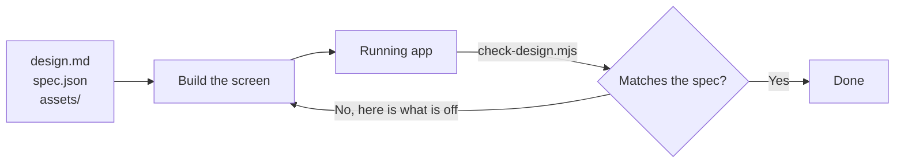

# Building a screen from a design pack

You have been given the design as files: `design/design.md` says what the design is,
`design/spec.json` says the same thing as facts a script can check, and `design/assets/`
holds its bitmaps. That is everything. You do not need Figma, a token, or a seat.



The loop is the point. Read the pack once, build the frame tree outside in, use the token
where one is given, then let the check tell you what is still wrong.

**No pack?** `prepare-figma-design` makes one from a figma.com link with a read-only
token. Do not implement from Figma MCP's `get_design_context` instead: it returns
reference markup, and building from markup means transliterating it — you rewrite someone
else's DOM and inherit a structure that was never meant to be code.

**Stale pack?** If the design has moved, the pack is regenerated by whoever has the
token, not patched by hand here. A hand-edited pack and a real design disagree silently.

## How to read the pack

```
- instance "Row" 312×64 at (0, 120) — `Ranked row` `State=Default`; a local component, used 3 times — implement once and reuse
  flex-direction: row; gap: spacing-8; padding: spacing-16
  - text "Title" 200×22 at (16, 141)
    text: "First"
    color: text2; typography: typography-14
  - instance "Icon Button" 32×32 at (264, 136) — `Icon Button` `Size=S, Type=Default, State=Default`
    flex-direction: row; padding: var(--charcoal-space-10); border-radius: var(--charcoal-radius-oval)
- instance "Row" 312×64 at (0, 184) — `Ranked row` `State=Default`; the same as "Row" at (0, 120) above
  text: "Second"
```

Each line is one element: its box, then its materials, then the component and variant it
came from. The nesting is the structure to build. Position children with their parent's
`gap` and `padding`, not with offsets on the children — the coordinates are there to
identify an element, not to be typed into your CSS.

Values with a token are written as that token. Values without one are literal — and that
is information too: it means the design system has no opinion here and you should not go
looking for a token.

**A bare word is a charcoal v1 role.** `color: text2`, `padding: spacing-16`,
`typography: typography-14` are keys of the v1 theme, which the design named through its
styles. The pack writes each once, and its header has a table of how each is spelled:
the Tailwind class (`text-text2`, `p-16`, `typography-14`), the styled-components theme
path (`theme.color.text2`), the v1 CSS variable (`var(--charcoal-text2)`), and the v2
variable with the same value where there is one. Use the column for the stack your
project is on; do not mix them.

**A comment naming a style or a variable** — `#fd9e16 /* style: Brand/Premium */` — is
a name the designer used that neither vocabulary has. The value before it is what it
looks like. If your project has a word for that name, use it; otherwise the literal.

**A local component is built once.** An instance marked "a local component, used N
times" is part of this design, not of the library, so its insides are described: build
it as one component and reuse it. A line that says "the same as … above" is another use
of it with different words — the structure is the first one's.

**Widths and heights are geometry, not tokens.** The design says a card is 294px wide
because the layout says so. There is no token for it and none is expected. If you find
yourself writing `height: var(--charcoal-text-line-height-100)` for a 72px header, the
number matched and the meaning did not.

**A color is read against what it sits on.** White is the resting text color of five
different roles at once, and nothing about the color says which. What says it is the
surface underneath, so a white label inside a primary container is written
`text/on-primary/default` rather than whichever white token sorts first.

Where the surface does not settle it, the pack says so instead of picking:

```
color: #ffffff /* text/on-on-img/default | text/on-primary/default | text/on-negative/default | text/on-positive/default | text/on-discovery/default */
```

That is the design system offering several words for this color and the design not
saying which. Choose the role the element actually plays.

**A gradient or a pattern is named, not valued.** `background: linear gradient /* no
token for this; read it from the design */` means there is a fill here that the design
system has no word for and the pack cannot write as a value. Open the design and copy
it. The one thing it does not mean is an unpainted box.

**There is no markup, on purpose.** The pack says what the design is. Turning that into
components, props and state is the implementation, and it is yours to write.

Where an element has words they are given as `text:` — use them verbatim. A node name is
its Figma layer, which is often a label rather than what it says.

## Before you write code: what the design does not tell you

A frame is one moment of a screen, drawn with sample data, for one user, in one theme.
The code is every moment of it. Most of what a reviewer sends back on a screen built
faithfully from a design is not in the design at all, so settle these first — in a few
lines of notes, not in your head — and build from the notes and the pack together.

1. **The data.** List what the screen shows that would come from somewhere: every text
   that is sample copy ("Title goes here", a user name, a count), every image, every
   number. That is the shape of the props or the response the screen renders from. Type
   it, and render the design from typed sample data instead of writing the copy into
   the markup — the copy in the frame is one row of that data, not the screen.
2. **Who owns each piece of state.** For every value that can change, say where it
   lives: the server (fetched, cached, paginated), the URL (tab, filter, date, page —
   anything a user would expect a link or the back button to keep), the component
   (open/closed, hover, a draft), or persisted on the device. A selected tab drawn in
   the frame is a URL parameter in most products, not a `useState`.
3. **The states the frame does not draw.** Enumerate them before writing, and handle or
   mark each one:
   - nothing to show (empty list, zero results), still loading, failed to load;
   - the longest real content: a title that wraps, a name in another script, a
     five-digit count, a translation longer than the original;
   - an image that is missing, still loading, or must not be shown to this user
     (sensitive, muted, restricted);
   - a signed-out viewer, and any viewer the product treats differently (paid,
     restricted age, a different locale or time zone);
   - the other theme, and the end of a paginated or infinite list.

   Look for each in the sibling frames prepare-figma-design listed next to this one;
   what is drawn is the answer. What is not drawn is not yours to invent: implement the
   project's existing pattern for it if there is one, and otherwise leave a visible
   `TODO` naming the missing state, and say so when you hand the work back.

4. **The units.** Split along the design's repetition and regions, not along Figma's
   layers: a component for the repeated item (the pack marks local components "used N
   times"), one per region of the screen, and hooks for the data and the state above.
   A single file that holds the screen, its sample data and its behaviour is the
   design transliterated, not implemented.
5. **What the screen is in the product.** Which interactive elements navigate (real
   links, so they open in a new tab and are announced as links) and which act in place
   (buttons). Every icon-only control needs an accessible name the frame does not show.

## In an existing app

The pack describes the design in the design system's words. A project that already has
screens has its own words on top, and those win:

- **Read the project's own conventions first** — `AGENTS.md`, `CLAUDE.md`, a
  contributing guide, a project skill for implementing designs. They say which styling
  route the project uses (so which column of the pack's role table to write), which
  components replace raw markup, and how text is localised.
- **Prefer the project's component, then charcoal's, then your own.** A design's
  "Bookmark" or "Avatar" instance is usually an existing component in the project with
  behaviour attached — tracking, permissions, sign-in prompts — that a lookalike drops.
  Search for the instance name and for its role before building one.
- **Copy goes through the project's i18n.** The words in the pack are the source
  language's; write them as translation keys the way neighbouring screens do, not as
  literals.
- **One vocabulary per file.** Do not mix Tailwind classes, styled theme paths and raw
  variables because the pack's table offered all three; match what the file's neighbours
  use.

## Check your own work

**`check-design.mjs` decides when you are done.** Run it, fix what it names, run it again.
An implementation that has never been rendered is a guess, however carefully it was built
from the pack — and the most expensive mistake it can make is invisible from the source:
a screen can import every component, write every value as a token, and render with none
of them applied.

With the app running:

```bash
node <this-skill>/bin/check-design.mjs --spec design/spec.json --url http://localhost:4173
```

`<this-skill>` is wherever this skill was installed:
`${CLAUDE_PLUGIN_ROOT}/skills/implement-figma-design` under the Claude Code plugin,
`.claude/skills/implement-figma-design` or `.agents/skills/implement-figma-design` under
`npx skills`.

It names what is off — outermost first, because a container in the wrong place moves
everything inside it — and says nothing about how well you did. The first thing it asks
is whether charcoal's variables resolve at all — v2's, or v1's as TokenInjector and the
Tailwind preset inject them, or for a v1 Tailwind build without variables, whether the
design's v1 colors are on the page — because that failure is the one the source cannot
show you. A v1 role is checked by the value it resolves to, so it passes however your
project spells it. Fix that before reading anything below it: until the tokens land,
every box will look wrong for the same single reason.

Needs `playwright` installed in the project being checked — it is resolved from there,
not from wherever this skill lives — and without it the check declines rather than
guessing.

## Every file it touches

`check-design.mjs` writes nothing at all: findings go to stdout, and the exit code is
what a script should branch on.

| Path            | R/W  | What                                                                             |
| --------------- | ---- | -------------------------------------------------------------------------------- |
| `--spec <path>` | read | The spec from the pack.                                                          |
| `--url <url>`   | read | The running app, over HTTP.                                                      |
| `playwright`    | read | Resolved from the project being checked, not from where this skill is installed. |

## What the pack does not replace

It is one frame as the designer drew it. It does not carry:

- **Which component in your library each instance is.** It gives you the component's
  name and its variant properties; the mapping is yours to make. Figma's `Search Field`
  is often your `TextField`. Check the names against your library's exports rather than
  trusting them — a wrong component mapping costs more than a wrong color.
- **Any state the frame is not drawn in.** Hover, focus, error and empty states are
  other frames, packed separately, or not in the file at all — see "Before you write
  code" above for how to enumerate and handle them.
- **Behaviour.** What a button does, what validates, what navigates where.
- **Where the data comes from.** Sample copy in the frame is one row of data, not a
  string to write into the screen.
- **The other theme.** The header says which theme and vocabulary it was resolved
  against; a dark screen built from a light pack gets every name right and every value
  wrong.
