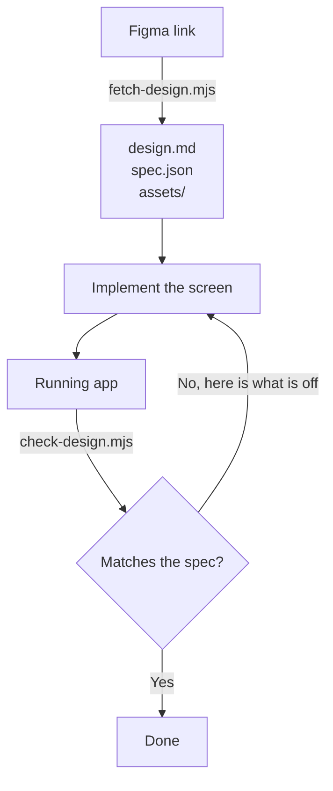

# Getting a Figma design in a form worth implementing

A design link holds two different things: where everything sits, and what everything is
made of. What you want is both, joined, with your own token names on the materials — and
nothing else. This emits exactly that, from Figma's free REST API.



The loop is the point. The first arrow is the only one that needs Figma, and it needs
nothing from Figma but a read-only token.

If you also have Figma's MCP and a Dev Mode seat, **still do not implement from
`get_design_context`.** It returns reference markup, and building from markup means
transliterating it: you rewrite someone else's DOM instead of building the design, and
you inherit a structure that was never meant to be code — wrapper divs that exist for
Figma's layout engine, absolute positioning where the design means a gap.

## Do this

Everything comes from the link. A read-only personal access token is enough, created at
Figma Settings → Security → Personal access tokens. No Dev Mode seat is needed.

The token is read from `FIGMA_TOKEN` in the environment. Ask whoever is running this to
put it there — a shell profile, a `.env` the project already loads, whatever they use for
credentials. Do not paste it into the command: an inline assignment lands in shell
history and in the environment of every process started from that shell.

```bash
node <this-skill>/bin/fetch-design.mjs \
  --url "https://www.figma.com/design/<key>/<name>?node-id=36-6579" \
  --tokens node_modules/@charcoal-ui/theme/src/json \
  --assets design/assets \
  > design/design.md
```

`<this-skill>` is wherever this skill was installed: `${CLAUDE_PLUGIN_ROOT}/skills/implement-figma-design`
under the Claude Code plugin, `.claude/skills/implement-figma-design` or
`.agents/skills/implement-figma-design` under `npx skills`.

`--tokens` points at your design system's Style Dictionary JSON. Without it values come
out literally; with it, every value the system has a token for is named as that token. A path that holds no tokens is an error rather than a
pack full of raw hex.

`--theme light|dark` picks which theme file to resolve against, defaulting to `light`.
The other theme's values are left out entirely, so a light design never gets named with
a dark token.

`--assets` downloads the design's bitmaps and names each on the box that paints it,
together with the `object-fit` its crop implies. Leave it out and the pack describes the
boxes without the images.

Then implement from `design/design.md`. Read it once, build the frame tree outside in,
and use the token where one is given.

## Check your own work

**`check-design.mjs` decides when you are done.** Run it, fix what it names, run it again.
An implementation that has never been rendered is a guess, however carefully it was built
from the pack — and the most expensive mistake it can make is invisible from the source:
a screen can import every component, write every value as a token, and render with none
of them applied.

Add `--spec design/spec.json` to the command above and the pack is also written as facts
a script can compare a render against. With the app running:

```bash
node <this-skill>/bin/check-design.mjs --spec design/spec.json --url http://localhost:4173
```

It names what is off — outermost first, because a container in the wrong place moves
everything inside it — and says nothing about how well you did. The first thing it asks
is whether charcoal's variables resolve at all, because that failure is the one the
source cannot show you.

Needs `playwright` installed in the project being checked — it is resolved from there,
not from wherever this skill lives — and without it the check declines rather than
guessing.

## Every file it touches

Nothing is written anywhere you did not name. There is no cache, no temp directory, and
nothing is ever written inside `node_modules` — the outputs describe _your_ screen, so
they belong in your repository next to the code they explain, where a reviewer can see
what the implementation was built from.

`fetch-design.mjs`

| Path                        | R/W   | What                                                                                                                                                             |
| --------------------------- | ----- | ---------------------------------------------------------------------------------------------------------------------------------------------------------------- |
| `FIGMA_TOKEN` (environment) | read  | The credential. Read only when a request is about to be made, never stored.                                                                                      |
| `--tokens <dir>`            | read  | Your design system's Style Dictionary JSON. For charcoal: `node_modules/@charcoal-ui/theme/src/json`. Read-only; one `*.json` per theme plus the shared palette. |
| stdout                      | write | The pack. Redirect it where you want it — the examples use `design/design.md`.                                                                                   |
| `--spec <path>`             | write | The same design as facts `check-design.mjs` can compare a render against. Only written when the flag is given.                                                   |
| `--assets <dir>/`           | write | The design's bitmaps, one file per image, named from its Figma reference. The directory is created if it is missing. Only written when the flag is given.        |

`check-design.mjs`

| Path            | R/W  | What                                                                             |
| --------------- | ---- | -------------------------------------------------------------------------------- |
| `--spec <path>` | read | The spec written above.                                                          |
| `--url <url>`   | read | The running app, over HTTP.                                                      |
| `playwright`    | read | Resolved from the project being checked, not from where this skill is installed. |

It writes no files at all: findings go to stdout, and the exit code is what a script
should branch on.

Why the tokens come from the JSON rather than charcoal's generated `light.css`: the CSS
keeps each token as a reference to another token (`var(--charcoal-color-light-blue-50)`)
where this needs the literal a Figma color can be matched against, and it flattens
`text/on-primary/default` into `text-on-primary-default`, losing the `/` boundaries that
tell a role from a state from a palette entry.

## What the output tells you, and what it deliberately does not

```
- instance "Icon Button" 32×32 at (296, 8) — `Size=S, Type=Default, State=Default`
  flex-direction: row; padding: var(--charcoal-space-10); border-radius: var(--charcoal-radius-oval)
  - instance "24 / Close" 24×24 at (300, 12) — `24 / Close`
    - vector "Shape" 14×14 at (305, 17)
      color: var(--charcoal-color-icon-tertiary-default)
```

Each line is one element: its box, then its materials, then the component and variant it
came from. Values with a token are written as that token. Values without one are literal
— and that is information too: it means the design system has no opinion here and you
should not go looking for a token.

**Widths and heights are geometry, not tokens.** The design says a card is 294px wide
because the layout says so. There is no token for it and none is expected. If you find
yourself writing `height: var(--charcoal-text-line-height-100)` for a 72px header, the
number matched and the meaning did not.

**A color is read against what it sits on.** White is the resting text color of five
different roles at once, and nothing about the color says which. What says it is the
surface underneath, so a white label inside a primary container is written
`text/on-primary/default` rather than whichever white token sorts first.

Where the surface does not settle it, the pack says so instead of picking:

```
color: #ffffff /* text/on-on-img/default | text/on-primary/default | text/on-negative/default | text/on-positive/default | text/on-discovery/default */
```

That is the design system offering several words for this color and the design not
saying which. Choose the role the element actually plays.

**There is no markup, on purpose.** The pack says what the design is. Turning that into
components, props and state is the implementation, and it is yours to write.

## What this does not replace

The pack is one frame as the designer drew it. It does not carry:

- **Which component in your library each instance is.** It gives you Figma's instance
  name and its variant properties; the mapping is yours to make. Figma's `Search Field`
  is often your `TextField`. Check the names against your library's exports rather than
  trusting them — a wrong component mapping costs more than a wrong color.
- **Any state the frame is not drawn in.** Hover, focus, error and empty states are
  other frames, or not in the file at all.
- **Behaviour.** What a button does, what validates, what navigates where.
