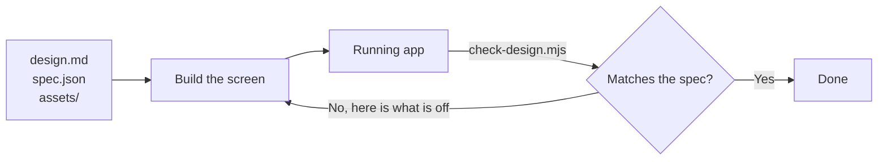

# Building a screen from a design pack

You have been given the design as files: `design/design.md` says what the design is,
`design/spec.json` says the same thing as facts a script can check, and `design/assets/`
holds its bitmaps. That is everything. You do not need Figma, a token, or a seat.



The loop is the point. Read the pack once, build the frame tree outside in, use the token
where one is given, then let the check tell you what is still wrong.

**No pack?** `prepare-figma-design` makes one from a figma.com link with a read-only
token. Do not implement from Figma MCP's `get_design_context` instead: it returns
reference markup, and building from markup means transliterating it — you rewrite someone
else's DOM and inherit a structure that was never meant to be code.

**Stale pack?** If the design has moved, the pack is regenerated by whoever has the
token, not patched by hand here. A hand-edited pack and a real design disagree silently.

## How to read the pack

```
- instance "Icon Button" 32×32 at (296, 8) — `Size=S, Type=Default, State=Default`
  flex-direction: row; padding: var(--charcoal-space-10); border-radius: var(--charcoal-radius-oval)
  - instance "24 / Close" 24×24 at (300, 12) — `24 / Close`
    - vector "Shape" 14×14 at (305, 17)
      color: var(--charcoal-color-icon-tertiary-default)
```

Each line is one element: its box, then its materials, then the component and variant it
came from. The nesting is the structure to build. Position children with their parent's
`gap` and `padding`, not with offsets on the children — the coordinates are there to
identify an element, not to be typed into your CSS.

Values with a token are written as that token. Values without one are literal — and that
is information too: it means the design system has no opinion here and you should not go
looking for a token.

**Widths and heights are geometry, not tokens.** The design says a card is 294px wide
because the layout says so. There is no token for it and none is expected. If you find
yourself writing `height: var(--charcoal-text-line-height-100)` for a 72px header, the
number matched and the meaning did not.

**A color is read against what it sits on.** White is the resting text color of five
different roles at once, and nothing about the color says which. What says it is the
surface underneath, so a white label inside a primary container is written
`text/on-primary/default` rather than whichever white token sorts first.

Where the surface does not settle it, the pack says so instead of picking:

```
color: #ffffff /* text/on-on-img/default | text/on-primary/default | text/on-negative/default | text/on-positive/default | text/on-discovery/default */
```

That is the design system offering several words for this color and the design not
saying which. Choose the role the element actually plays.

**A gradient or a pattern is named, not valued.** `background: linear gradient /* no
token for this; read it from the design */` means there is a fill here that the design
system has no word for and the pack cannot write as a value. Open the design and copy
it. The one thing it does not mean is an unpainted box.

**There is no markup, on purpose.** The pack says what the design is. Turning that into
components, props and state is the implementation, and it is yours to write.

Where an element has words they are given as `text:` — use them verbatim. A node name is
its Figma layer, which is often a label rather than what it says.

## Check your own work

**`check-design.mjs` decides when you are done.** Run it, fix what it names, run it again.
An implementation that has never been rendered is a guess, however carefully it was built
from the pack — and the most expensive mistake it can make is invisible from the source:
a screen can import every component, write every value as a token, and render with none
of them applied.

With the app running:

```bash
node <this-skill>/bin/check-design.mjs --spec design/spec.json --url http://localhost:4173
```

`<this-skill>` is wherever this skill was installed:
`${CLAUDE_PLUGIN_ROOT}/skills/implement-figma-design` under the Claude Code plugin,
`.claude/skills/implement-figma-design` or `.agents/skills/implement-figma-design` under
`npx skills`.

It names what is off — outermost first, because a container in the wrong place moves
everything inside it — and says nothing about how well you did. The first thing it asks
is whether charcoal's variables resolve at all, because that failure is the one the
source cannot show you. Fix that before reading anything below it: until the tokens land,
every box will look wrong for the same single reason.

Needs `playwright` installed in the project being checked — it is resolved from there,
not from wherever this skill lives — and without it the check declines rather than
guessing.

## Every file it touches

`check-design.mjs` writes nothing at all: findings go to stdout, and the exit code is
what a script should branch on.

| Path            | R/W  | What                                                                             |
| --------------- | ---- | -------------------------------------------------------------------------------- |
| `--spec <path>` | read | The spec from the pack.                                                          |
| `--url <url>`   | read | The running app, over HTTP.                                                      |
| `playwright`    | read | Resolved from the project being checked, not from where this skill is installed. |

## What the pack does not replace

It is one frame as the designer drew it. It does not carry:

- **Which component in your library each instance is.** It gives you Figma's instance
  name and its variant properties; the mapping is yours to make. Figma's `Search Field`
  is often your `TextField`. Check the names against your library's exports rather than
  trusting them — a wrong component mapping costs more than a wrong color.
- **Any state the frame is not drawn in.** Hover, focus, error and empty states are
  other frames, or not in the file at all.
- **Behaviour.** What a button does, what validates, what navigates where.
- **Which theme it is.** `--theme dark` and `--theme light` give different token names
  for the same drawing, and the pack does not record which was used. Ask if it matters.
