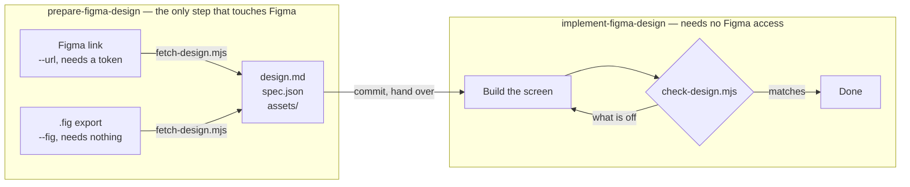

# Getting a Figma design out of Figma, once, for everyone

A design link holds two different things: where everything sits, and what everything is
made of. What an implementer wants is both, joined, with your own token names on the
materials — and nothing else. This emits exactly that, from Figma's free REST API.

It is deliberately a separate step from building the screen, because the two jobs need
different things. This one needs a Figma credential and access to the file. Building the
screen needs neither.



Run this once and commit what it writes. Whoever builds the screen — a teammate, an
agent, you tomorrow — works from those files and never needs the token, the file
permission, or a seat.

If you also have Figma's MCP and a Dev Mode seat, **still do not hand over
`get_design_context`.** It returns reference markup, and building from markup means
transliterating it: the implementer rewrites someone else's DOM instead of building the
design, and inherits a structure that was never meant to be code — wrapper divs that
exist for Figma's layout engine, absolute positioning where the design means a gap.

## Do this

There are two ways in, and they produce the same three files. Use the link if you can
reach the file; use a `.fig` when you have no token, when Figma is unreachable, or when
you want a pack rebuildable from something committed.

### From a link

A read-only personal access token is enough, created at Figma Settings → Security →
Personal access tokens. No Dev Mode seat is needed.

The token is read from `FIGMA_TOKEN` in the environment. Ask whoever is running this to
put it there — a shell profile, a `.env` the project already loads, whatever they use for
credentials. Do not paste it into the command: an inline assignment lands in shell
history and in the environment of every process started from that shell.

```bash
node <this-skill>/bin/fetch-design.mjs \
  --url "https://www.figma.com/design/<key>/<name>?node-id=36-6579" \
  --tokens node_modules/@charcoal-ui/theme/src/json \
  --assets design/assets \
  --spec design/spec.json \
  > design/design.md
```

`<this-skill>` is wherever this skill was installed:
`${CLAUDE_PLUGIN_ROOT}/skills/prepare-figma-design` under the Claude Code plugin,
`.claude/skills/prepare-figma-design` or `.agents/skills/prepare-figma-design` under
`npx skills`.

### From a `.fig`

File → Save local copy in Figma writes a `.fig`: the whole document, and every bitmap in
it. Reading one needs no token, no network and no access to the original file — the
bitmaps come straight out of the archive instead of being downloaded.

```bash
node <this-skill>/bin/fetch-design.mjs \
  --fig design.fig \
  --node 110-8609 \
  --tokens node_modules/@charcoal-ui/theme/src/json \
  --assets design/assets \
  --spec design/spec.json \
  > design/design.md
```

`--node` is required here and takes the `node-id` from the frame's link, because a
`.fig` holds the whole file and there is no one frame to default to. Right-click the
frame in Figma → Copy link to get it.

Two things to know. It needs Node 22.15 or newer, because a recent export compresses its
document with zstd. And it reads the design as the export froze it, so a `.fig` taken
last month describes last month's design however current the link looks.

### Either way

`--tokens` points at your design system's Style Dictionary JSON. Without it values come
out literally; with it, every value the system has a token for is named as that token. A
path that holds no tokens is an error rather than a pack full of raw hex.

`--theme light|dark` picks which theme file to resolve against, defaulting to `light`.
The other theme's values are left out entirely, so a light design never gets named with
a dark token.

`--assets` downloads the design's bitmaps and names each on the box that paints it,
together with the `object-fit` its crop implies. Leave it out and the pack describes the
boxes without the images.

`--spec` writes the same design as facts a script can compare a render against. Pass it:
it is what lets the implementer check their own work, and it costs nothing to produce
here. Without it they can build the screen but cannot tell when they are done.

## Then hand it over

Commit all three — `design/design.md`, `design/spec.json`, `design/assets/` — and point
whoever is building at `implement-figma-design`. They are the complete input. Nothing
else from Figma is needed, and no part of this step has to be repeated until the design
itself changes.

Say which frame it is and which theme you resolved against. `--theme dark` and
`--theme light` produce different token names for the same drawing, and nothing in the
pack records which you picked.

**Re-run this when the design changes, not when the implementation does.** The pack is a
snapshot of one frame as the designer drew it; a stale pack is worse than none, because
the check loop will keep reporting a screen as wrong when it is the design that moved.

## Every file it touches

Nothing is written anywhere you did not name. There is no cache, no temp directory, and
nothing is ever written inside `node_modules` — the outputs describe _your_ screen, so
they belong in your repository next to the code they explain, where a reviewer can see
what the implementation was built from.

| Path                        | R/W   | What                                                                                                                                                             |
| --------------------------- | ----- | ---------------------------------------------------------------------------------------------------------------------------------------------------------------- |
| `FIGMA_TOKEN` (environment) | read  | The credential, for `--url` only. Read only when a request is about to be made, never stored. Never read on the `--fig` route.                                   |
| `--fig <file>`              | read  | A local Figma export. The only input the `--fig` route has: no network call is made at all.                                                                      |
| `--tokens <dir>`            | read  | Your design system's Style Dictionary JSON. For charcoal: `node_modules/@charcoal-ui/theme/src/json`. Read-only; one `*.json` per theme plus the shared palette. |
| stdout                      | write | The pack. Redirect it where you want it — the examples use `design/design.md`.                                                                                   |
| `--spec <path>`             | write | The same design as facts `check-design.mjs` can compare a render against. Only written when the flag is given.                                                   |
| `--assets <dir>/`           | write | The design's bitmaps, one file per image, named from its Figma reference. The directory is created if it is missing. Only written when the flag is given.        |

Why the tokens come from the JSON rather than charcoal's generated `light.css`: the CSS
keeps each token as a reference to another token (`var(--charcoal-color-light-blue-50)`)
where this needs the literal a Figma color can be matched against, and it flattens
`text/on-primary/default` into `text-on-primary-default`, losing the `/` boundaries that
tell a role from a state from a palette entry.

## What you are handing over

```
- instance "Icon Button" 32×32 at (296, 8) — `Size=S, Type=Default, State=Default`
  flex-direction: row; padding: var(--charcoal-space-10); border-radius: var(--charcoal-radius-oval)
  - instance "24 / Close" 24×24 at (300, 12) — `24 / Close`
    - vector "Shape" 14×14 at (305, 17)
      color: var(--charcoal-color-icon-tertiary-default)
```

Each line is one element: its box, then its materials, then the component and variant it
came from. `implement-figma-design` explains how to read it; what matters here is that
it is complete without Figma, and that there is no markup in it on purpose.

A fill the design system cannot name — a gradient, a pattern — is written as what it
is, `background: linear gradient /* ... */`, rather than left out. A box painted with a
gradient must not read like a box painted with nothing.

If the pack comes out full of raw hex, `--tokens` is pointing at the wrong directory —
fix that before handing it over, because a literal reads as "the design system has no
word for this" and sends the implementer looking for one that does not exist.
